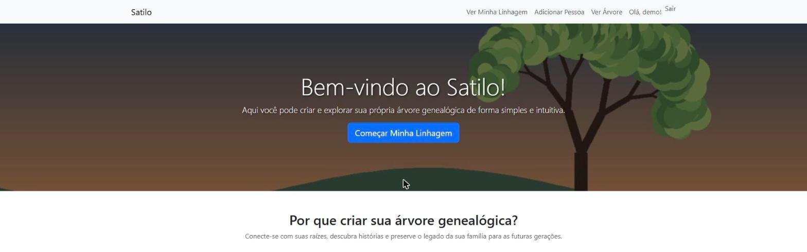
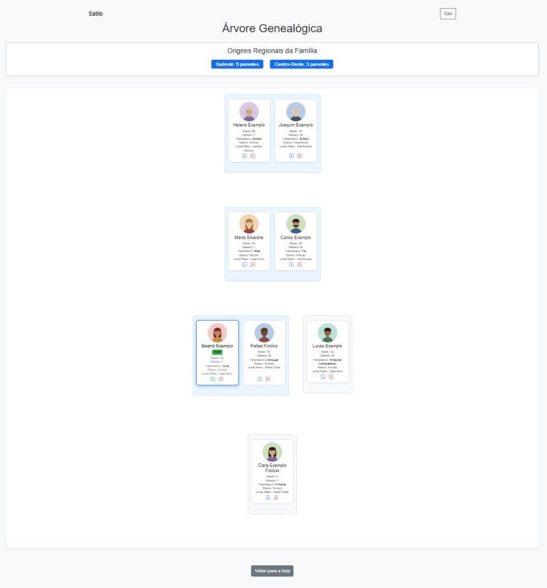

# Satilo

**PT:** Projeto pessoal: uma aplicação web em Django para criar e visualizar árvores genealógicas. Todos os dados e imagens de demonstração são fictícios.

**EN:** Personal project: a Django web app for building and viewing family trees. All demo data and images are fictional.




## Como rodar / How to run

```bash
python -m venv venv
source venv/bin/activate      # Windows: venv\Scripts\activate
pip install -r requirements.txt
python manage.py migrate
python manage.py seed_demo    # usuário/user: demo / demo12345
python manage.py runserver
```

Acesse / Open: http://127.0.0.1:8000/

Testes / Tests: `python manage.py test`

Configuração opcional / Optional settings: veja / see `.env.example`.

## Licença / License

MIT
